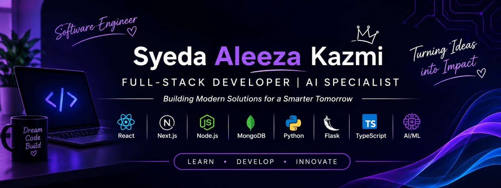
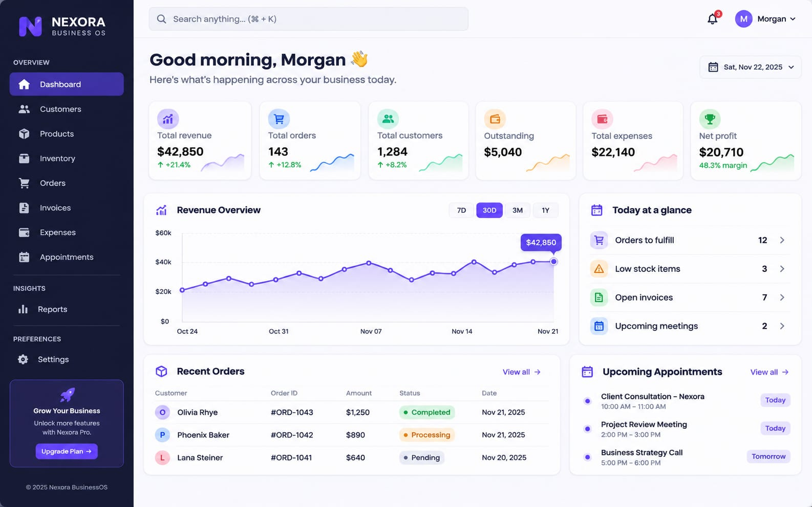
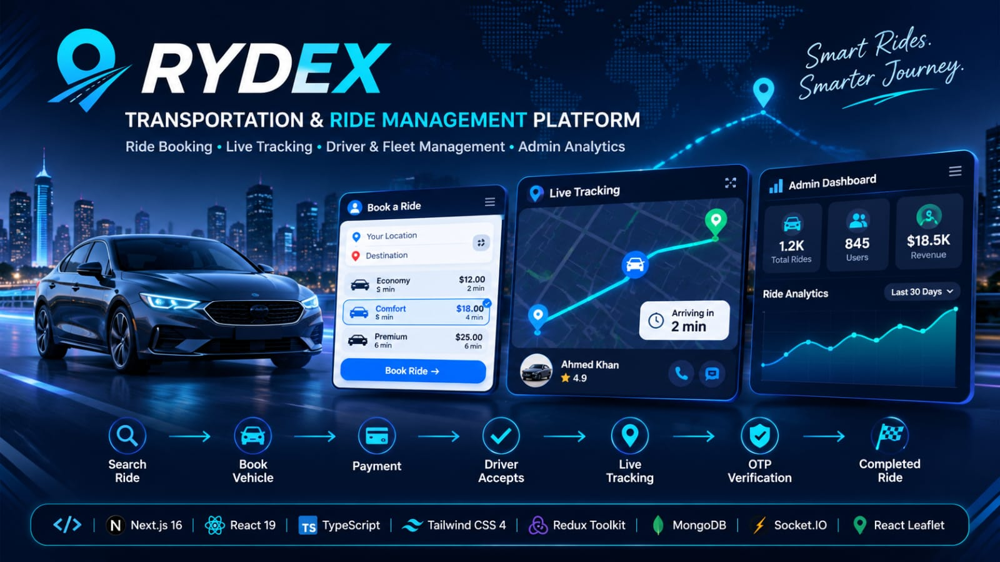
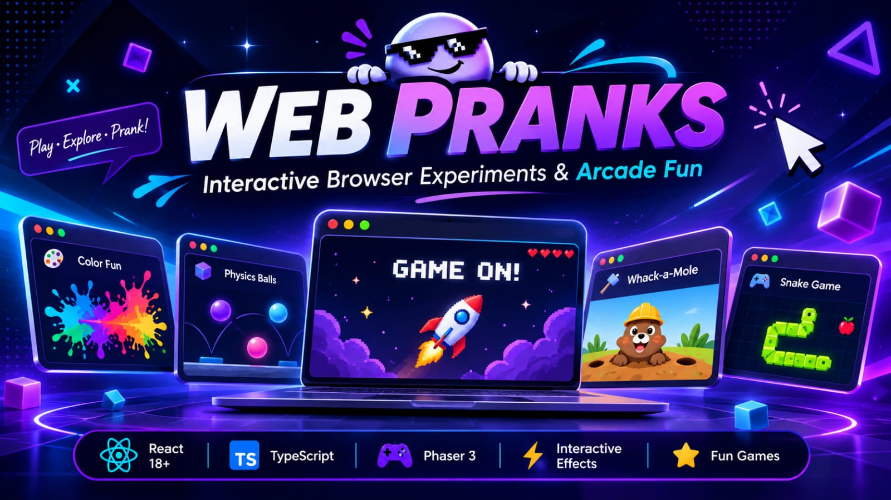

  

---

## 👩‍💻 About Me

- 💻 Full-Stack Developer specializing in MERN Stack.
- 🤖 Interested in Artificial Intelligence and Machine Learning.
- 🐍 Building applications with Python and Flask.
- 🌱 Continuously learning and exploring new technologies.
- 🚀 Passionate about creating useful digital experiences.

## 🛠️ Tech Stack

## 🚀 Featured Projects

### 💼 1. Nexora BusinessOS
Modern SaaS business management platform built with Next.js, TypeScript and Tailwind CSS.

[View Repository](https://github.com/Aleezy-code/nexora-businessos)

  

### 🚘 2. RYDEX – Transportation Booking & Dispatch
Transportation booking and dispatch management platform.

[View Repository](https://github.com/Aleezy-code/transportation-booking-dispatch-system)

  

### 🤖 3. AI Career Navigator
AI-powered resume analyzer with NLP, skill extraction and job matching.

[View Repository](https://github.com/Aleezy-code/AI-Career-Navigator)

  

# 🎮 Web Pranks

An interactive web experience built with React,
TypeScript, and Phaser 3.

Explore creative browser effects, physics-based
animations, and entertaining interactive experiences.

## ✨ Features

- Interactive browser experiences
- Physics-based animations
- Creative visual effects
- Engaging frontend interactions
- Arcade-style experiences

## 🛠️ Tech Stack

- React
- TypeScript
- Phaser 3

## 🌐 Live Demo

[Explore Web Pranks](https://webfun.click/)

## 👩‍💻 Developer

**Syeda Aleeza Kazmi**

[GitHub](https://github.com/Aleezy-code)

  

### 🔐 5. Runaway Authentication
Authentication system featuring Supabase, email verification and protected routes.

[View Repository](https://github.com/Aleezy-code/runaway-login)

  

### 🌌 6. Aleeza 3D Showcase
Creative 3D portfolio experience with modern interactive visuals.

[View Repository](https://github.com/Aleezy-code/aleeza-3d-showcase)

## 📊 GitHub Statistics

<h2 align="center">📈 Contribution Activity</h2>

  

---

--- 

## 🌐 Connect With Me

  
  

  💼 Open to exciting projects, collaborations and opportunities.

---

  <i>Thanks for visiting my GitHub profile! ✨</i>

---

<h2 align="center">🐍 My GitHub Contribution Snake</h2>

  <picture>
    <source media="(prefers-color-scheme: dark)"
      srcset="https://raw.githubusercontent.com/Aleezy-code/Aleezy-code/output/github-snake-dark.svg">
    
  </picture>

---
